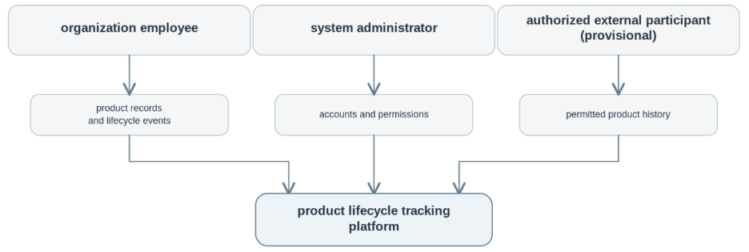
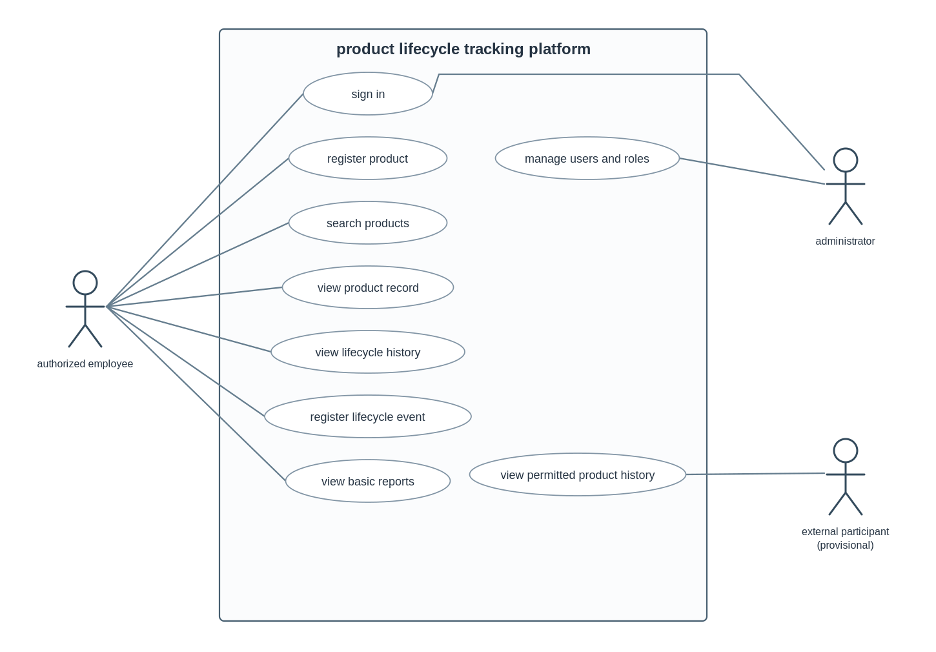
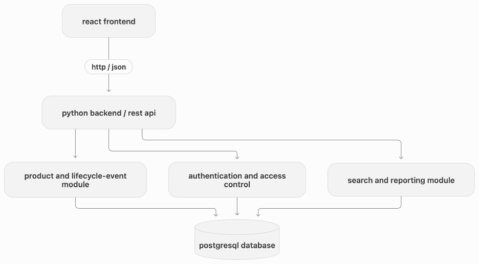

### fig. 1. system context diagram

## fig. 2. use case diagram

## fig. 3. component diagram (preliminary)

The proposed platform follows a three-tier web architecture consisting of a React frontend, a Python backend, and a relational database.

The frontend provides interfaces for product registration, lifecycle history, search, and reporting. The backend handles product records, lifecycle events, authentication, and access control. A separate search and reporting module supports information retrieval.

The system context and use case diagrams illustrate the proposed participants and core operations. The component diagram presents the preliminary internal structure.

The architecture will be refined after user research and finalization of the project requirements.
